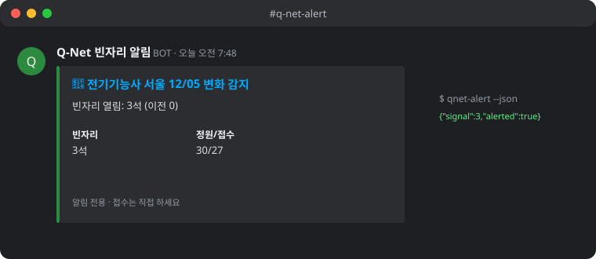
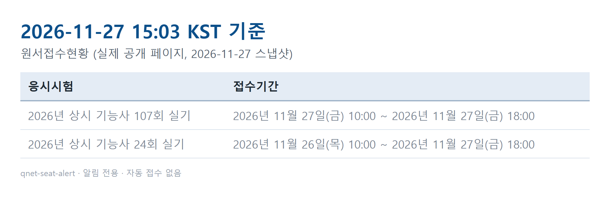
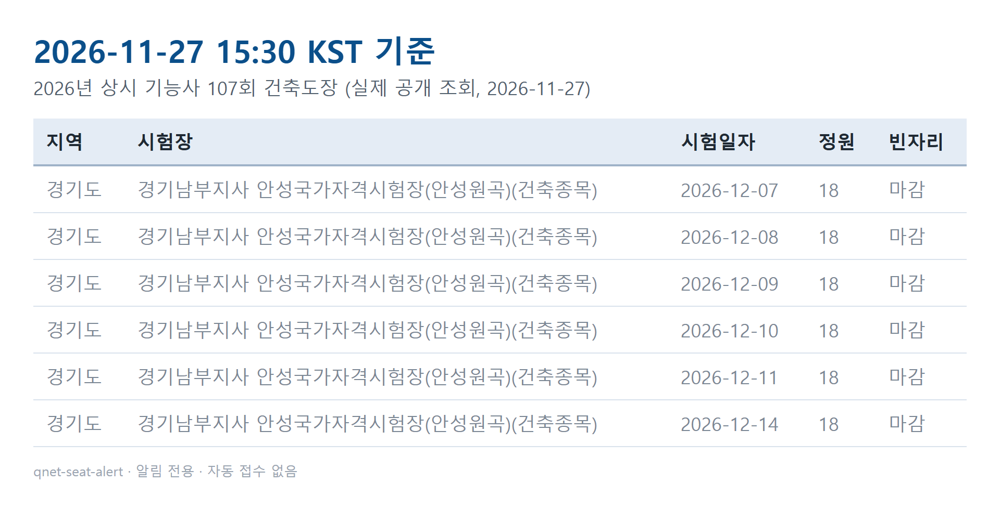
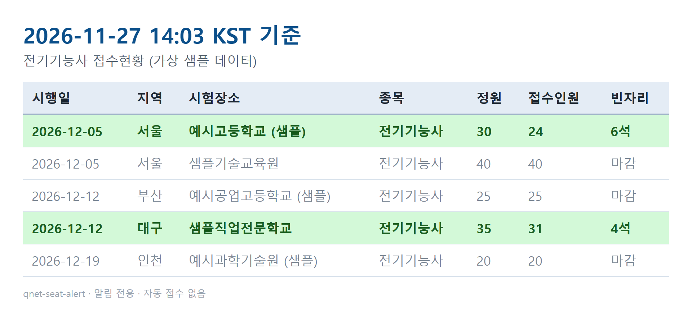

<div align="center">

# 🔔 qnet-seat-alert

**Q-Net 원서접수 빈자리가 열리면 Discord · Slack · Telegram 으로 알려주는 알림 전용 감시기**

[English](README.md) · **한국어**

[](https://github.com/lilicoderr/qnet-seat-alert/actions/workflows/ci.yml)


[](LICENSE)



</div>

> **알림 전용입니다.** 자동 접수·로그인·매크로는 하지 않습니다. 접수는 사람이 직접 합니다.
> Q-Net 자동 조회는 이용약관에 저촉될 수 있으니 **개인 확인 용도로만** 쓰세요. 평소에는 3~10분 간격을, 1분(프리셋 기본)은 짧은 접수 기간에만 권장합니다.

## 5분 빠른 시작 (Windows)

PowerShell 에서 위에서부터 그대로 실행합니다. 예시는 `건축도장` / `서울` 이니 본인의 종목과 지역으로 바꾸세요.

**0. 설치** (처음 한 번): [Node.js 20 이상](https://nodejs.org)과 [Git](https://git-scm.com)을 설치하고 PowerShell 을 새로 엽니다. `node --version` 이 `v20` 이상이면 됩니다. `npm install` 은 필요 없습니다.

**1. 받기**

```powershell
git clone https://github.com/lilicoderr/qnet-seat-alert
cd qnet-seat-alert
```

이후 명령은 모두 이 폴더에서 실행합니다 (`.env` 와 `config.json` 을 여기서 읽습니다).

**2. 종목과 지역 설정**

```powershell
node bin/qnet-alert.js init --preset gineungsa --jongmok 건축도장 --region 서울
```

- `--jongmok`: 종목 이름의 일부 (예: `전기기능사`). `--region`: 시도 이름의 일부 (예: `서울`, `대구`).
- `config.json` 이 만들어집니다. `.env.example exists, skipped` 는 정상입니다. 설정을 다시 만들려면 `--force` 를 붙입니다 (`.env.example` 도 새로 씁니다. `.env` 는 건드리지 않습니다).

**3. Discord 웹훅과 내 ID 넣기**

```powershell
copy .env.example .env
notepad .env
```

`.env` 에서 아래 두 줄을 채우고 저장합니다. `=` 뒤에 값만 적고, **같은 줄에 설명이나 `#` 주석을 달지 마세요.** (이미 `.env` 를 만들었다면 `copy` 를 다시 하지 마세요. 내용이 덮어써집니다.)

```text
QNET_DISCORD_WEBHOOK=
QNET_MENTION_USERS=
```

- **웹훅 URL**: Discord 에서 알림 받을 채널의 톱니바퀴(채널 편집) > **연동** > **웹후크** > **새 웹후크** > **웹후크 URL 복사**. 서버 관리 권한이 없으면 내 서버를 하나 만들면 됩니다.
- **내 사용자 ID** (핑 받기, 선택): **사용자 설정 > 고급 > 개발자 모드**를 켜고, 내 프로필/이름을 우클릭 > **사용자 ID 복사**. 숫자만 넣고, 여러 명은 쉼표로 구분합니다. 닉네임은 안 됩니다.
- 웹훅 URL 은 비밀번호와 같습니다. 채팅, 이슈, 스크린샷에 올리지 마세요. `.env` 는 git 에서 제외됩니다.

**4. 점검**

```powershell
node bin/qnet-alert.js doctor
```

`[FAIL]` 줄의 `→ 해결:` 안내대로 고치고 다시 실행합니다. 설정, `.env`, 채널 형식, 멘션 ID, Q-Net 접속을 확인하며 알림은 보내지 않습니다. (네트워크 점검을 빼려면 `--offline`.) 종목 이름은 여기서 확인하지 않습니다 (6번 참고).

**5. Discord 테스트**

```powershell
node bin/qnet-alert.js test --channel discord
```

`[ OK ] discord#1` 이 나오고 채널에 `qnet-alert test` 메시지가 오면 성공입니다. `QNET_MENTION_USERS` 를 넣었다면 이 메시지에서 핑이 오는지도 확인하세요.

**6. 감시 시작**

```powershell
node bin/qnet-alert.js --dry     # 한 번만 조회, 전송 없음, 상태 저장 없음
.\start-watch.bat                # 계속 감시 (탐색기에서 더블클릭해도 됨)
```

- 접수 중인 시험이 있을 때 종목/지역에 오타가 있으면 `--dry` 출력에 가능한 이름 목록이 나옵니다. 접수 중인 시험이 없으면 `signal=0` 이며 오타는 이때 확인되지 않습니다.
- 프리셋은 1분마다 확인하고 `tableImage.every: true` 라서 **체크마다 현황표 이미지를 Discord 에 올립니다**. 표가 바뀔 때만 받으려면 `config.json` 에서 `"every": false` 로 바꾸세요 (이미지에는 Chrome 또는 Edge 를 사용).
- 창을 닫거나 Ctrl+C 를 누르면 감시가 멈춥니다. PC 가 절전 상태여도 멈춥니다.

### 로그인할 때 자동 실행 (작업 스케줄러)

위 6번까지 확인한 뒤, 프로젝트 폴더에서:

```powershell
powershell -ExecutionPolicy Bypass -File .\deploy\windows-task.ps1
Start-ScheduledTask -TaskName qnet-seat-alert
Get-ScheduledTask -TaskName qnet-seat-alert     # State 가 Running 이면 감시 중
```

- 내 계정으로 로그인할 때마다 시작합니다. 콘솔 창이 보이면 닫지 마세요. 폴더를 옮기면 스크립트를 다시 실행합니다.
- `start-watch.bat` 과 **동시에 실행하지 마세요** (알림이 두 번 옵니다).
- 중지: `Stop-ScheduledTask -TaskName qnet-seat-alert`
- 삭제: `Unregister-ScheduledTask -TaskName qnet-seat-alert -Confirm:$false`
- "액세스가 거부되었습니다" 가 나오면 PowerShell 을 관리자 권한으로 열고 다시 실행합니다.

### 안 될 때

| 증상 | 해결 |
|---|---|
| `node` 를 찾을 수 없음 | Node.js 설치 후 PowerShell 을 새로 열기 |
| `no notification channels` | 파일 이름이 `.env` 인지 (`.env.txt` 아님), 프로젝트 폴더에 있는지 확인 |
| `test` 가 `[FAIL] ... (401)` 또는 `(404)` | 웹훅이 삭제됐거나 URL 이 잘림. 새로 복사 |
| 메시지는 오는데 핑이 없음 | `QNET_MENTION_USERS` 가 숫자 ID 인지 `doctor` 로 확인, Discord 알림 설정 확인 |
| `종목 '...' 없음` / `지역 '...' 없음` | 메시지에 나온 가능한 이름으로 2번을 `--force` 와 함께 다시 실행 |
| 이미지만 안 옴 | Chrome/Edge 설치 확인 또는 `.env` 의 `QNET_CHROME` 지정 |

### 인터넷 없이 흐름 확인 (선택)

저장해 둔 실제 페이지로 조회 흐름을 돌립니다. 저장본에는 `건축도장`/`방수` 종목만 있어, 다른 종목으로 설정했다면 `FAIL` 이 정상입니다.

```powershell
node bin/qnet-alert.js doctor --fixture test/fixtures/real/rcv00301-2026-11-27.html
```

## 로그인 없이 감시할 수 있는 것

2026-11-27 에 로그인 없이, 쿠키 없이, CAPTCHA 없이 평범한 익명 요청으로 실제 확인했습니다 (HTTP 200). 브라우저에서 방문자가 쓰는 조회(원서접수현황 > 현황보기)와 같은 읽기 전용 요청이며, 접수 자체(`rcv202.do`)는 절대 호출하지 않습니다.

| 단계 | 요청 | 결과 |
|---|---|---|
| 1 | `GET rcv003.do?id=rcv00301` | 접수 중인 시험과 접수기간. 각 행의 현황보기 버튼에 계획 ID 가 들어 있음 |
| 2 | `POST rcv003.do?id=rcv00302` | 그 시험의 종목 목록 (예: 건축도장기능사 / 방수기능사) |
| 3 | `POST rcv003.do?id=rcv00303` + `rcv00303s02` | 지역 목록, 응시세부유형 (`rcv00303s02` 는 **EUC-KR** 로 응답) |
| 4 | `POST rcv003.do?id=rcv00303s03` | 시험장별 지역, 기관명, 시험일자, 입실시간, 시험장소, 정원, 현재접수 가능인원 |

실제로 정원(예: 18)과 현재접수 가능인원이 있는 시험장 행을 확인했습니다. 다만 그 시점에는 모든 행이 `마감` 이어서 **숫자로 된 잔여석 값은 아직 직접 보지 못했습니다**. 따라서 숫자 잔여석은 **실제 데이터로는 미검증**이며, 해당 경로 테스트는 실제 마크업에서 만든 합성 fixture(`test/fixtures/synthetic/`, 합성임을 명시)로 합니다. 파서는 `마감` 또는 숫자만 인식하고, 그 밖의 문구는 추측하지 않고 "파서 이상" 알림을 냅니다. 미확인: 필기 시험(당시 접수 중인 것이 없었음), 확인에 쓴 종목/지역 외의 경우. 연간 시험일정 페이지(`crf021.do`)는 JavaScript 로 그려져 파싱할 수 없습니다.

`type: "qnet"` 감시는 이 단계를 체크마다 실행해 기존 알림/멘션/표 이미지로 연결합니다.

```json
{ "name": "건축도장 잔여석", "type": "qnet", "url": "https://www.q-net.or.kr/rcv003.do?gSite=Q&id=rcv00301",
  "examPattern": "기능사", "jongmok": "건축도장", "region": "서울", "dateFrom": "2026-12-01" }
```

- `examPattern`: 시험 이름 정규식 (기본 `기능사`). `jongmok`: 필수, 종목 이름 일부. `region`: 시도 이름 일부 (Q-Net 에도 필터로 전달). `recptCd`: 응시자유형, 기본 `01`(필기합격자). `include`/`exclude`/`dateFrom`/`dateTo`: 행 필터. `showClosed: false`: 접수 가능한 시험장만 요청 (요청은 줄지만 전부 마감이면 이미지가 비어 있음).
- **권장 설정:** `intervalMin: 1`, `region` 지정 (Q-Net 에도 전달되어 결과 페이지가 줄어듦), `maxPages` 는 기본 5 (체크당 상한), `pageDelayMs` 1500 (결과 페이지 사이 간격). `region` 이 없으면 `doctor` 가 1분 간격에서 분당 최대 `maxPages` 건의 요청이 나간다고 경고합니다.
- **예의:** HTTP 429/5xx 이면 즉시 재시도하지 않고 다음 체크들을 건너뜁니다 (2분, 4분, 8분, 최대 16분). 네트워크 오류는 1~3단계를 다시 돌리지 않으며, "맞는 접수 중 시험 없음"은 5분 캐시합니다 (접수 시작이 5분 안으로 다가오면 매 체크 확인).
- **실제 체크당 요청 수:** 시험이 접수 중이고 `region` 이 있으면 보통 1건(10곳짜리 결과 한 페이지), 한 종목 전국은 2페이지(약 2건, 1.5초 간격), 30분마다 정적 단계 4건이 추가됩니다. 접수 중인 시험이 없으면 5분에 1건.
- **체크당 비용(상세):** 1~3단계는 `refreshMin`(기본 30분) 동안 캐시되므로 한 번의 체크는 4단계 결과 페이지 수만큼(한 페이지 10곳, 한 종목 전국 2페이지, `region` 을 주면 더 적음)의 요청입니다. 맞는 시험이 접수 중이 아니면 1단계 요청 한 번뿐이고 잔여석 0 으로 처리합니다. 1분 간격이면 분당 대략 1~3 요청이며, `region` 으로 줄일 수 있습니다.
- 시험이 끝났거나 응답이 달라 보이면 캐시를 한 번 버리고 재시도합니다. 구조를 알 수 없으면 무엇이 없는지(예: 유효한 종목 이름)를 알려 주는 파서 이상 알림을 보냅니다.
- 점검 페이지, HTTP 5xx, EUC-KR/UTF-8 본문을 처리합니다.

1단계 목록만으로는 `newrows` 감시가 가능하며, 기능사 필기 같은 새 항목이 처음 나타날 때 한 번 알립니다. `기능사.*필기` 패턴은 현재 실기 항목의 이름 형식에서 추정한 값이며 실제 필기 목록으로는 확인하지 못했습니다.

실제 fixture 로 만든 표 이미지 (`scripts/make-real-sample-image.js`, `scripts/make-seat-sample-image.js`):





## 특징

- **의존성 0** — Node 20+ 내장 `fetch` 만 사용
- **멀티 채널** — Discord, Slack, Telegram, 일반 웹훅을 동시에
- **정밀 필터** — `include` / `exclude` / 날짜 범위로 "내가 볼 시험 행"만 감시
- **중복 알림 억제** — 0석→1석 이상으로 *열릴 때* 한 번만 (`open` / `increase` / `change` / `available`)
- **튼튼한 폴링** — 5xx·429·네트워크 오류는 지수 백오프, 연속 실패 시 "감시 오류" 알림
- **비밀값 분리** — 웹훅/토큰은 `.env` 환경변수로, 로그에서는 자동 마스킹
- **운영 친화적** — `--dry`, `--json` 구조화 로그, Docker, Actions 스케줄 예시
- **대화형 설정** — `qnet-alert init` 이 `config.json` 과 `.env.example` 을 만들어 줌 (비밀값은 묻지 않음)
- **하트비트** — N시간마다 "아직 감시 중" 요약 알림으로 조용히 죽은 감시기를 발견
- **문구 템플릿** — `{name}` `{available}` 같은 변수로 알림 제목/본문 변경
- **Prometheus 메트릭** — 선택적 `/metrics`, `/healthz` (기본 127.0.0.1 바인딩)
- **친절한 설정 검증** — 오타 키/값은 "혹시 ○○ 말씀이세요?" 로 안내

## CLI

`node bin/qnet-alert.js <명령/옵션>` 형태로 실행합니다. 아무것도 없으면 `intervalMin` 간격으로 계속 감시합니다.

| 옵션 | 설명 |
|---|---|
| `doctor [--offline] [--fixture f]` | 설정, `.env`, 채널, 멘션, 접속 점검 (전송 없음) |
| `test [--channel discord] [--dry]` | 선택한 채널에만 테스트 알림 (설정한 멘션 포함) |
| `export [--hours N] [--out f.csv]` | `historyPath` 이력을 CSV 로 내보내기 |
| `dashboard [--port 8787]` | 읽기 전용 로컬 대시보드 (127.0.0.1) |
| `init --preset gineungsa --jongmok <종목> --region <지역>` | 질문 없이 기능사 감시 설정 생성 |
| `--once` | 1회 검사 후 종료 |
| `--dry` | 한 번 조회해 결과만 출력. 전송과 상태 저장 없음 (웹훅 불필요) |
| `--list` | 설정된 watcher 목록 |
| `--test-webhook` | 설정된 모든 알림 채널에 테스트 전송 |
| `--json` | 한 줄 JSON 로그 (로그 수집기용) |
| `--quiet` | 변화·오류가 없는 줄은 출력 생략 |
| `--config <path>` | 설정 파일 (기본 `config.json`, 또는 `$QNET_CONFIG`) |
| `--metrics-port <n>` | Prometheus `/metrics` 서버 열기 (또는 `metricsPort`) |
| `stats [--hours 24] [--json]` | `historyPath` 이력으로 워처별 스파크라인·최소/최대/빈자리 비율 출력 |
| `init [--force]` | 대화형 설정 마법사 (기존 파일은 `--force` 없으면 보존) |

## 설정

### 알림 채널

환경변수(권장) 또는 `config.json` 의 `notifiers` 로 지정합니다.

| 채널 | 환경변수 | `notifiers` 항목 |
|---|---|---|
| Discord | `QNET_DISCORD_WEBHOOK` | `{ "type": "discord", "url": "…" }` |
| Slack | `QNET_SLACK_WEBHOOK` | `{ "type": "slack", "url": "…" }` |
| Telegram | `QNET_TELEGRAM_TOKEN`, `QNET_TELEGRAM_CHAT` | `{ "type": "telegram", "token": "…", "chatId": "…" }` |
| 일반 웹훅 | `QNET_WEBHOOK_URL` | `{ "type": "webhook", "url": "https://…" }` |
| 이메일 (SMTP) | `QNET_SMTP_HOST`, `QNET_SMTP_PORT`, `QNET_SMTP_USER`, `QNET_SMTP_PASS`, `QNET_EMAIL_FROM`, `QNET_EMAIL_TO` | `{ "type": "email", "host": "smtp.example.com", "from": "a@example.com", "to": ["b@example.com"] }` (465 = TLS, 587 = STARTTLS) |
| ntfy.sh | `QNET_NTFY_TOPIC` (+ `QNET_NTFY_SERVER`, `QNET_NTFY_TOKEN`) | `{ "type": "ntfy", "topic": "my-seats" }` |

> 구버전의 최상위 `webhookUrl` 도 그대로 동작합니다(Discord). 워처별 `webhookUrl` 은 해당 워처만 그 채널로 보냅니다.

### 최상위 옵션

| 키 | 기본 | 설명 |
|---|---|---|
| `intervalMin` | `5` | 폴링 간격(분), 최소 1 (60초) |
| `politeDelayMs` | – | 워처 사이 대기(ms) |
| `failureAlertAfter` | `5` | 연속 실패 N회에 "감시 오류" 알림 1회 (`0` 이면 끔) |
| `statePath` | `state.json` | 마지막 신호 저장 파일 (`$QNET_STATE`) |
| `heartbeatHours` | – | N시간마다 "감시 중" 요약 알림 (첫 실행엔 기준만 기록) |
| `templates` | – | `{ "title": "…", "description": "…" }` 알림 문구. 워처의 `template` 이 우선 |
| `metricsPort` / `metricsHost` | – / `127.0.0.1` | Prometheus 엔드포인트 (`/metrics`, `/healthz`) |
| `plugins` | – | 알림 채널 플러그인 모듈 경로 목록, [docs/plugins.md](docs/plugins.md) 참고 |
| `lang` | `ko` | 기본 알림 문구 언어: `ko` 또는 `en` (직접 쓴 `templates` 가 항상 우선) |
| `parserAlertAfter` | `3` | 페이지는 받아지는데 값을 N회 연속 못 읽으면 "파서 오류" 알림을 한 번 전송 (`0` 이면 끔) |
| `digest` | `false` | `true` 면 같은 점검에서 발생한 알림을 한 통으로 묶음 |
| `historyPath` | – | 측정값을 이 JSONL 파일에 누적, `qnet-alert stats` 로 확인 |
| `quietHours` | – | `{ "start": "23:00", "end": "07:00", "timezone": "Asia/Seoul" }` — 이 시간대에 발생한 알림은 보류했다가 끝나면 전송 |
| `jitter` | `0.1` | 매 대기 시간을 `intervalMin` 의 ±이 비율만큼 무작위로 흔듦 (0~0.5) |
| `mentions` | – | `{ "users": [...], "roles": [...], "slack": [...], "cooldownMin": 0, "whileAvailable": true }` — 빈자리가 보이는 동안 멘션 ([멘션](#멘션) 참고) |
| `tableImage` | – | `{ "every": false, "chrome": "", "width": 960 }` — 현황표를 PNG 로 첨부 ([현황표 이미지](#현황표-이미지) 참고) |
| `rateLimit` | – | `{ "maxPerHour": 6 }` — 시간당 알림 상한 (초과분은 로그만 남기고 건너뜀) |

템플릿 변수: `{name}` `{available}` `{applied}` `{capacity}` `{signal}` `{reason}` `{url}` `{time}`
예) `"title": "🎯 {name} {available}석!"`

### 멘션

`mentions`(또는 `QNET_MENTION_*` 환경변수)를 설정하면, 닫힘→열림 전환 때만이 아니라 **빈자리가 보이는 매 체크마다** 지정한 사람을 멘션합니다. `cooldownMin`(기본 `0` = 매 체크)으로 간격을 둘 수 있고, `"whileAvailable": false` 면 전환 때만 알립니다. ID 는 코드가 아니라 설정/환경변수로만 받습니다.

```bash
# .env (자리표시자)
# Discord 사용자 ID, 역할 ID, Slack 멤버 ID (주석은 이렇게 별도 줄에)
QNET_MENTION_USERS=123456789012345678,234567890123456789
QNET_MENTION_ROLES=345678901234567890
QNET_MENTION_SLACK=U0123ABCD
```

Discord 는 `<@USER_ID>` / `<@&ROLE_ID>` 를 보내고 `allowed_mentions` 로 **해당 ID 만** 알림이 가게 합니다 (`@everyone`/`@here` 불가). Slack 은 `<@U...>` 를 씁니다.

#### Discord 사용자/역할 ID 얻는 법

1. 개발자 모드 켜기: **사용자 설정 > 고급 > 개발자 모드**.
2. 사용자 ID: 사용자 우클릭 후 **사용자 ID 복사** (모바일: 사용자를 길게 누르거나 ... 메뉴에서 **사용자 ID 복사**).
3. 역할 ID: **서버 설정 > 역할 > ... > 역할 ID 복사**. 역할은 **모든 사람이 이 역할을 멘션하도록 허용** 이 켜져 있어야 알림이 갑니다.
4. `.env` 의 `QNET_MENTION_USERS` / `QNET_MENTION_ROLES` (쉼표 구분) 또는 `config.json` 의 `mentions` 에 넣으세요.

### 현황표 이미지

`tableImage` 를 설정하면 현재 현황표(시행일·지역·시험장소·종목·정원·접수·빈자리)를 PNG 로 그려 웹훅 메시지에 첨부합니다. 맨 위 줄은 **2026-11-27 14:03 KST 기준** 처럼 확인 시각(KST)이고, 빈자리가 있는 행은 초록색으로 강조됩니다.

```json
{ "tableImage": { "every": true } }
```

- `every: true` 면 체크마다 보내고, 기본값 `false` 는 지난 체크와 표가 달라졌을 때만 보냅니다 (첫 체크는 변화로 취급).
- **체크당 메시지 1통.** Discord 는 알림 임베드와 현황표 이미지를 multipart 한 통으로 보내며(이미지는 임베드 안에 표시), 멘션 문구는 정확히 한 번만 들어가고 `allowed_mentions` 는 설정한 ID 로만 제한됩니다. 알림이 없는 체크라도 `every` 가 켜져 있으면 멘션 없는 이미지 전용 메시지를 보냅니다. 멘션은 `cooldownMin` 을 따르고, 조용한 시간에는 이미지 포함 아무것도 보내지 않으며, `rateLimit` 는 합쳐진 메시지 기준입니다. Telegram 은 알림 본문을 캡션으로 한 `sendPhoto` 한 통입니다. Slack 인커밍 웹훅은 파일 업로드가 안 되어 텍스트 알림만 갑니다.
- 이미지 높이는 실제 레이아웃을 먼저 측정(headless 1차 실행)해서 정하므로 긴 시험장 이름이 줄바꿈돼도 잘리지 않습니다. Chrome 은 샌드박스를 켠 채 실행하며, `--no-sandbox` 는 Linux 에서 root 로 실행할 때(예: 컨테이너)만 추가됩니다. 그 경우 Chrome 이 샌드박스로는 시작을 거부하기 때문입니다.
- **렌더러 선택:** npm 의존성·Playwright 없이, 설치된 Chrome/Chromium/Edge 의 headless 스크린샷을 씁니다 (자동 탐지, `tableImage.chrome` 또는 `QNET_CHROME` 으로 지정). 브라우저가 없으면 이미지만 건너뛰고 오류를 기록하며 텍스트 알림은 그대로 갑니다.
- 가상의 fixture 데이터로 만든 샘플 (`node scripts/make-sample-image.js`):



### Watcher

| 키 | 설명 |
|---|---|
| `name`, `id` | 표시 이름 / 상태 저장용 식별자 |
| `url`, `linkUrl` | 가져올 URL / 알림에 붙일 링크 |
| `type` | `seats` · `jsonseats` · `contains` · `regex` · `newrows` · `qnet` |
| `alertOn` | `open`(기본) · `increase` · `change` · `available` |
| `include` / `exclude` | 행 필터 — 모든 `include` 키워드를 포함하고 `exclude` 는 없는 행만 사용 |
| `dateFrom` / `dateTo` | 행의 날짜(`2026.12.05`, `2026-12-05`, `2026년 12월 5일`)가 `YYYY-MM-DD` 범위일 때만 |
| `mention` | 알림 본문에 넣을 멘션 |
| `schedule` | cron 형식 `분 시 일 월 요일` (로컬 시간, 예: `*/10 9-18 * * 1-5`): 마지막 실행 이후 일정이 도래했을 때만 실행. 루프 주기는 전역 `intervalMin` 이 정함 |
| `enabled` | `false` 면 건너뜀 |

| type | 동작 |
|---|---|
| `seats` | HTML 텍스트에서 "정원/접수인원", "잔여 N석", "28/30", "30명 중 28명" 을 찾아 계산 |
| `jsonseats` | JSON 응답의 정원/접수/잔여 필드로 계산 (`fields` 로 키 지정) |
| `contains` | 문구(`needle`) 등장/사라짐 감지 (`alertWhen`: present/absent/change) |
| `regex` | `pattern` 1번 그룹 값 변화 감지 |
| `qnet` | Q-Net 공개 현황보기 페이지에서 시험장별 정원/잔여석을 읽기 전용으로 다단계 조회 (`examPattern`, `jongmok`, `region` ...) |
| `newrows` | 공개 원서접수현황 목록에서 `pattern`/`needle` 에 맞는 새 행이 생기면 한 번만 알림 (`alertOnFirst`: 첫 실행에 이미 있는 행도 알림) |

## 동작 방식

```text
poll ─▶ fetch(+backoff) ─▶ row filter ─▶ extract ─▶ decide(prev, cur) ─▶ notify[Discord|Slack|Telegram|Webhook]
                                                          ▲
                                                     state.json (중복 억제)
```

## 테스트

```bash
npm test      # node --test — 네트워크 없이 fetch 주입으로 검증
```

## 한계

잔여석은 Q-Net 공개 시험장 조회("로그인 없이 감시할 수 있는 것" 참고)에서 읽습니다. 숫자 잔여석 값은 아직 직접 보지 못했고(당시 모든 시험장이 마감) 필기 목록도 미확인입니다. 이 도구는 로그인도 접수도 하지 않으며 자동 접수는 의도적으로 지원하지 않습니다.

## 기여

[CONTRIBUTING.md](CONTRIBUTING.md) · [CHANGELOG.md](CHANGELOG.md) · [MIT License](LICENSE)

## 배포

Windows 작업 스케줄러는 위 빠른 시작을 보세요. systemd, PM2, Docker, GitHub Actions 설정은 [docs/deploy.md](docs/deploy.md) 참고.

## 핫 리로드

실행 중 설정 파일이 바뀌면 30초 이내에 자동으로 다시 읽고, `SIGHUP`(`kill -HUP <pid>`, Linux/macOS)을 보내면 즉시 읽습니다. 새 설정이 잘못됐으면 오류만 출력하고 이전 설정으로 계속 동작합니다.

## 에디터 자동완성

[`schemas/config.schema.json`](schemas/config.schema.json) JSON Schema 를 제공합니다. `config.json` 맨 위에 `"$schema": "./schemas/config.schema.json"` 을 넣으면 VS Code 등에서 자동완성과 오류 표시가 됩니다.
