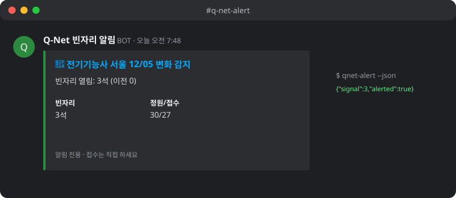
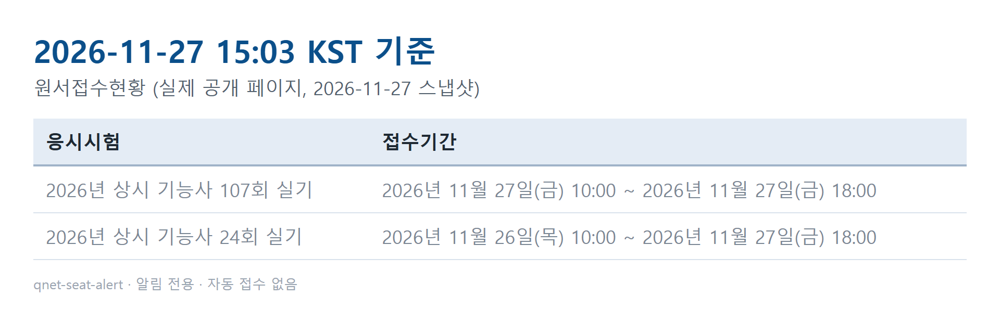
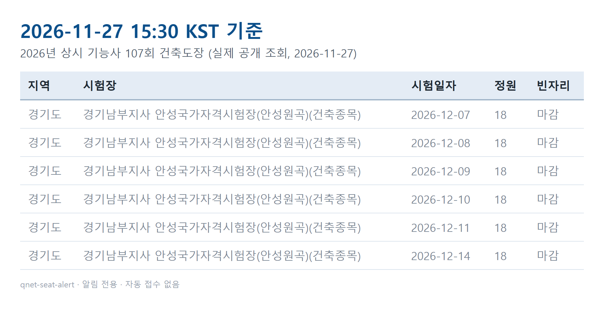
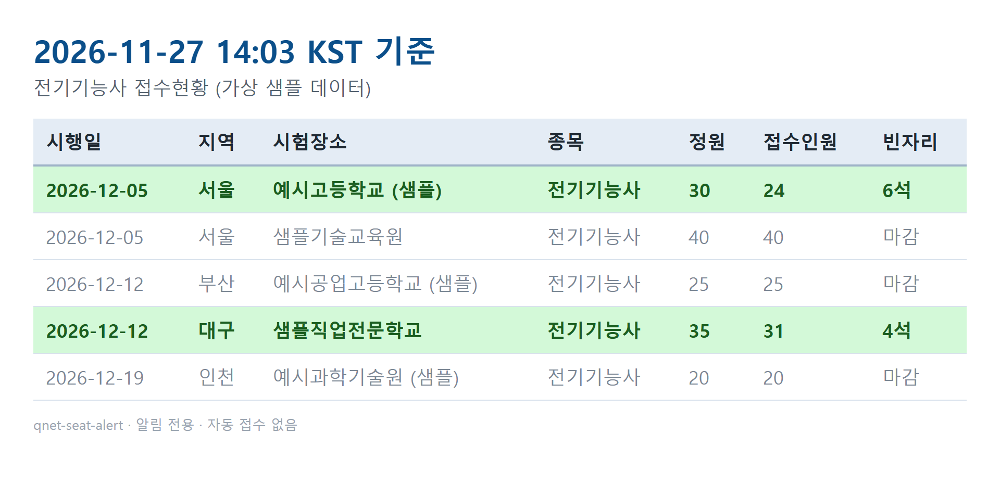

<div align="center">

# 🔔 qnet-seat-alert

**An alert-only watcher that pings Discord · Slack · Telegram when a Q-Net exam seat opens up.**

[](https://github.com/lilicoderr/qnet-seat-alert/actions/workflows/ci.yml)


[](LICENSE)

**English** · [한국어](README.ko.md)



</div>

> **Alert-only.** No auto-registration, no login, no macros — you register by hand.
> Automated access to Q-Net may violate its terms of service, so use this for **personal checks only**. Prefer 3-10 minutes day to day; keep 1 minute (the preset) for short registration windows.

[Q-Net](https://www.q-net.or.kr/) is Korea's national technical-qualification portal. Seats for popular exams (기능사 practical tests, etc.) vanish in minutes and reappear when someone cancels. This tool watches pages **you** point it at and tells you the moment a seat reopens.

## 5-minute quickstart (Windows)

한국어 안내(설명이 더 자세함): [README.ko.md](README.ko.md#5분-빠른-시작-windows)

Needs [Node.js 20+](https://nodejs.org) and [Git](https://git-scm.com). No `npm install`. Run in PowerShell, replacing `건축도장` / `서울` with your 종목 and region.

```powershell
git clone https://github.com/lilicoderr/qnet-seat-alert
cd qnet-seat-alert
node bin/qnet-alert.js init --preset gineungsa --jongmok 건축도장 --region 서울
copy .env.example .env
notepad .env
```

`.env.example exists, skipped` is normal in a fresh clone. In `.env`, fill these two lines (value only, **no comment on the same line**):

```text
QNET_DISCORD_WEBHOOK=
QNET_MENTION_USERS=
```

- **Webhook URL:** channel settings (gear) > **Integrations** > **Webhooks** > **New Webhook** > **Copy Webhook URL**. Treat it like a password.
- **Your user ID** (optional, to be pinged): see [How to get a Discord user/role ID](#how-to-get-a-discord-userrole-id). Digits only, comma separated.

```powershell
node bin/qnet-alert.js doctor                 # checks setup, sends nothing; FAIL lines say what to fix
node bin/qnet-alert.js test --channel discord # expect "[ OK ] discord#1" and a message (with your ping)
node bin/qnet-alert.js --dry                  # one live check, sends nothing, saves no state
.\start-watch.bat                             # keep watching (or double-click it)
```

The preset checks every minute and posts a seat-table image **on every check**; set `tableImage.every` to `false` in `config.json` to get it only when the table changes. Closing the window or letting the PC sleep stops the watcher. A misspelled 종목/지역 can only be detected while a matching exam is open (`--dry` then lists the valid names).

### Start at logon (Task Scheduler)

```powershell
powershell -ExecutionPolicy Bypass -File .\deploy\windows-task.ps1
Start-ScheduledTask -TaskName qnet-seat-alert
Get-ScheduledTask -TaskName qnet-seat-alert     # State: Running
```

It starts whenever you log on. Don't also run `start-watch.bat` (duplicate alerts). Re-run the script if you move the folder. Stop with `Stop-ScheduledTask -TaskName qnet-seat-alert`; remove with `Unregister-ScheduledTask -TaskName qnet-seat-alert -Confirm:$false`. If you get "Access is denied", use an administrator PowerShell.

Offline check of the lookup flow on stored real pages (they only contain 건축도장/방수, so other 종목 report `FAIL` here):

```powershell
node bin/qnet-alert.js doctor --fixture test/fixtures/real/rcv00301-2026-11-27.html
```

## What can be watched without login

Verified live on 2026-11-27 with plain anonymous requests (no login, no cookies sent, no CAPTCHA, HTTP 200). This is the same read-only lookup a visitor uses in the browser (원서접수현황 > 현황보기). Nothing under `rcv202.do` (the application itself) is ever called.

| Step | Request | Result |
|---|---|---|
| 1 | `GET rcv003.do?id=rcv00301` | Open exams and their 접수기간; each row's 현황보기 button carries the plan ids |
| 2 | `POST rcv003.do?id=rcv00302` | The 종목 (qualification) list of that exam, e.g. 건축도장기능사 / 방수기능사 |
| 3 | `POST rcv003.do?id=rcv00303` + `rcv00303s02` | Region list and applicant-type detail (`rcv00303s02` answers in **EUC-KR**) |
| 4 | `POST rcv003.do?id=rcv00303s03` | Per venue: 지역, 기관명, 시험일자, 입실시간, 시험장소, 정원, 현재접수 가능인원 |

Seen live: real venue rows with 정원 (e.g. 18) and 현재접수 가능인원. At that moment every row read `마감` (full), so **a numeric remaining-seat value has not been observed yet**. Numeric remaining values are therefore **unverified on real data**: the tests for that path use a clearly labelled synthetic fixture (`test/fixtures/synthetic/`, derived from the real markup). The parser accepts `마감` or a number and raises a "parser broke" alert for any other text instead of guessing. Not verified: 필기 exams (none were open), other 종목/regions beyond the one used. The annual schedule pages (`crf021.do`) are rendered by JavaScript and cannot be parsed.

Watcher `type: "qnet"` runs these steps each check and feeds the normal alert, mention and table-image pipeline:

```json
{ "name": "건축도장 잔여석", "type": "qnet", "url": "https://www.q-net.or.kr/rcv003.do?gSite=Q&id=rcv00301",
  "examPattern": "기능사", "jongmok": "건축도장", "region": "서울", "dateFrom": "2026-12-01" }
```

- `examPattern`: regex on the exam name (default `기능사`). `jongmok`: required, part of the 종목 name. `region`: part of the 시도 name, also sent to Q-Net as the filter. `recptCd`: applicant type, default `01` (필기합격자). `include`/`exclude`/`dateFrom`/`dateTo`: row filters. `showClosed: false`: ask only for open venues (cheaper, but the image is empty while everything is full).
- **Recommended settings:** `intervalMin: 1`, `region` set (it is also sent to Q-Net, so fewer result pages come back), `maxPages` left at the default 5 (hard cap per check), `pageDelayMs` 1500 (pause between result pages). Without `region`, `doctor` warns that a 1-minute interval costs up to `maxPages` requests per minute.
- **Politeness:** on HTTP 429/5xx the watcher skips the next checks (2 min, then 4, 8, up to 16 min) instead of retrying at once; network errors do not re-run steps 1-3; "no matching open exam" is cached for 5 minutes (re-checked every minute once an exam's 접수 start is within 5 minutes).
- **Real request cost per check:** with an exam open and `region` set, typically 1 request (one result page of 10 venues); nationwide for one 종목 it is 2 pages (about 2 requests, 1.5 s apart); every 30 minutes the static steps add 4 more. With no exam open: 1 request per 5 minutes.
- **Cost per check (detail):** steps 1-3 are cached for `refreshMin` (default 30) minutes, so a check is one request per result page of step 4 (10 venues per page; 2 pages nationwide for one 종목, fewer with `region`). While no matching exam is open a check is only the step-1 request and reports 0 seats. 1-minute polling is therefore about 1-3 requests per minute; set `region` to keep it small.
- If the exam closes or a response looks different, the cache is dropped once and retried. Unknown layouts give a parser-broken alert that names what was missing (for example the valid 종목 names).
- Maintenance pages, HTTP 5xx and EUC-KR/UTF-8 bodies are handled.

The public list alone (step 1) also supports the `newrows` watcher, which alerts once when a new entry such as a 기능사 필기 window appears. The `기능사.*필기` pattern is a guess from the naming of the current 실기 entries and is unverified against a real 필기 listing.

Table images from the real fixtures (`scripts/make-real-sample-image.js`, `scripts/make-seat-sample-image.js`):





## Features

- **Zero dependencies** — Node 20+ built-in `fetch` only
- **Multi-channel** — Discord, Slack, Telegram and generic webhooks at once
- **Precise filters** — `include` / `exclude` keywords and a date range, so you only watch the rows you care about
- **No duplicate pings** — fires once when seats *open* (`open` / `increase` / `change` / `available`), and survives restarts via a state file
- **Robust polling** — exponential backoff on 5xx / 429 / network errors, plus a one-time "watcher is failing" alert
- **Secrets stay out of config** — webhooks/tokens come from `.env`; they are redacted from logs
- **Interactive setup** — `qnet-alert init` writes `config.json` and `.env.example` (it never asks for secrets)
- **Heartbeat** — a periodic "still watching" summary so a silently dead watcher gets noticed
- **Message templates** — `{name}`, `{available}`, … variables for alert titles and bodies
- **Prometheus metrics** — optional `/metrics` and `/healthz` (binds to 127.0.0.1 by default)
- **Helpful validation** — typos in keys or values get a "did you mean …?" hint
- **Ops-friendly** — `--dry`, `--json` structured logs, Docker, a scheduled GitHub Actions example

## CLI

Run as `node bin/qnet-alert.js <command/option>`. With none, it keeps watching every `intervalMin`.

| Option | Description |
|---|---|
| `doctor [--offline] [--fixture f]` | Check config, `.env`, channels, mentions and reachability (sends nothing) |
| `test [--channel discord] [--dry]` | Send a test alert, including configured mentions, to the chosen channel |
| `export [--hours N] [--out f.csv]` | Export `historyPath` readings as CSV |
| `dashboard [--port 8787]` | Read-only local dashboard (127.0.0.1) |
| `init --preset gineungsa --jongmok <name> --region <area>` | Non-interactive 기능사 setup |
| `--once` | Check once and exit |
| `--dry` | One check without sending or saving state (no webhook needed) |
| `--list` | List configured watchers |
| `--test-webhook` | Send a test message to every configured channel |
| `--json` | One JSON object per log line (for log collectors) |
| `--quiet` | Hide lines with no change and no error |
| `--config <path>` | Config file (default `config.json`, or `$QNET_CONFIG`) |
| `--metrics-port <n>` | Serve Prometheus `/metrics` (or set `metricsPort`) |
| `stats [--hours 24] [--json]` | Text sparkline + min/max/open-rate per watcher from `historyPath` |
| `init [--force]` | Interactive setup wizard (existing files are kept unless `--force`) |

## Configuration

### Notification channels

Set via environment variables (recommended) or `notifiers` in `config.json`.

| Channel | Environment variables | `notifiers` entry |
|---|---|---|
| Discord | `QNET_DISCORD_WEBHOOK` | `{ "type": "discord", "url": "…" }` |
| Slack | `QNET_SLACK_WEBHOOK` | `{ "type": "slack", "url": "…" }` |
| Telegram | `QNET_TELEGRAM_TOKEN`, `QNET_TELEGRAM_CHAT` | `{ "type": "telegram", "token": "…", "chatId": "…" }` |
| Generic webhook | `QNET_WEBHOOK_URL` | `{ "type": "webhook", "url": "https://…" }` |
| Email (SMTP) | `QNET_SMTP_HOST`, `QNET_SMTP_PORT`, `QNET_SMTP_USER`, `QNET_SMTP_PASS`, `QNET_EMAIL_FROM`, `QNET_EMAIL_TO` | `{ "type": "email", "host": "smtp.example.com", "from": "a@example.com", "to": ["b@example.com"] }` (465 = TLS, 587 = STARTTLS) |
| ntfy.sh | `QNET_NTFY_TOPIC` (+ `QNET_NTFY_SERVER`, `QNET_NTFY_TOKEN`) | `{ "type": "ntfy", "topic": "my-seats" }` |

> A top-level legacy `webhookUrl` still works (Discord). A per-watcher `webhookUrl` routes only that watcher to that channel.

### Top-level options

| Key | Default | Description |
|---|---|---|
| `intervalMin` | `5` | Polling interval in minutes (minimum 1, i.e. 60 s; fractions like 1.5 work) |
| `politeDelayMs` | – | Pause between watchers (ms) |
| `failureAlertAfter` | `5` | Send one "watcher failing" alert after N consecutive failures (`0` disables). Retried until delivered; cancelled if monitoring recovers first |
| `statePath` | `state.json` | File holding the last signal (`$QNET_STATE`) |
| `heartbeatHours` | – | Send a "still watching" summary every N hours (first run only records a baseline) |
| `templates` | – | `{ "title": "…", "description": "…" }` alert text; a watcher's `template` overrides it |
| `metricsPort` / `metricsHost` | – / `127.0.0.1` | Prometheus endpoint (`/metrics`, `/healthz`) |
| `plugins` | – | Paths of notifier plugin modules to load, see [docs/plugins.md](docs/plugins.md) |
| `lang` | `ko` | Language of built-in alert messages: `ko` or `en` (your own `templates` always win) |
| `parserAlertAfter` | `3` | Send one "parser broke" alert after N consecutive checks where the page loads but no value can be read (`0` disables). Retried until delivered; cancelled if monitoring recovers first |
| `digest` | `false` | `true` merges alerts raised in the same check into one message |
| `historyPath` | – | Append every reading to this JSONL file; view it with `qnet-alert stats` |
| `quietHours` | – | `{ "start": "23:00", "end": "07:00", "timezone": "Asia/Seoul" }` — alerts raised in this window are held and sent once it ends. The two failure warnings are also deferred, and sent only if still broken then |
| `jitter` | `0.1` | Randomize each wait by ±this fraction of `intervalMin` (0–0.5) so requests don't land on a fixed beat; see [Polite polling](#polite-polling) |
| `mentions` | – | `{ "users": [...], "roles": [...], "slack": [...], "cooldownMin": 0, "whileAvailable": true }` — ping people while seats are open, see [Mentions](#mentions) |
| `tableImage` | – | `{ "every": false, "chrome": "", "width": 960 }` — attach the seat table as a PNG, see [Table image](#table-image) |
| `rateLimit` | – | `{ "maxPerHour": 6 }` — cap alerts per hour; extra ones are skipped (logged only). Failure warnings are counted separately (delivered ones only) and wait for the next free slot while the outage lasts |

Template variables: `{name}` `{available}` `{applied}` `{capacity}` `{signal}` `{reason}` `{url}` `{time}` — e.g. `"title": "🎯 {name}: {available} seats!"`.

### Polite polling

This tool is alert-only and is meant to be gentle with Q-Net:

- **Minimum interval: 60 seconds (`intervalMin: 1`).** Lower values are raised to 1. 1 minute is for short, important windows; 3-10 minutes is the polite everyday choice. Jitter still applies.
- **Jitter:** each wait is randomized by +/-10% by default (`jitter`).
- **Identifiable User-Agent:** requests send `qnet-seat-alert/<version> (+repo URL; personal alert-only watcher; low-frequency)`. A watcher's `headers` can override it.
- Failures back off exponentially (up to 2 retries); `politeDelayMs` spaces out multiple watchers.
- It never logs in, never registers and never pays.

### Mentions

When `mentions` (or the `QNET_MENTION_*` env vars) is set, every check that sees an open seat pings the listed people, not only the first closed-to-open transition. `cooldownMin` (default `0` = every check) spaces the repeated pings out; `"whileAvailable": false` restores transition-only alerts. IDs come from config or the environment, never from the code:

```bash
# .env (placeholders)
# Discord user IDs, role IDs, Slack member IDs (keep comments on their own line)
QNET_MENTION_USERS=123456789012345678,234567890123456789
QNET_MENTION_ROLES=345678901234567890
QNET_MENTION_SLACK=U0123ABCD
```

Discord sends `<@USER_ID>` / `<@&ROLE_ID>` and sets `allowed_mentions` so **only those IDs** are pinged (never `@everyone`/`@here`). Slack gets `<@U...>`. Telegram does not support ID mentions.

#### How to get a Discord user/role ID

1. Enable Developer Mode: **User Settings > Advanced > Developer Mode**.
2. User ID: right-click the user, then **Copy User ID** (mobile: long-press the user, or the ... menu, then **Copy User ID**).
3. Role ID: **Server Settings > Roles > ... > Copy Role ID**. The role needs **Allow anyone to @mention this role** (Roles > the role > Display), otherwise the ping will not notify anyone.
4. Put the IDs in `.env` as `QNET_MENTION_USERS` / `QNET_MENTION_ROLES` (comma-separated) or in `config.json` under `mentions`.

### Table image

With `tableImage` set, the current seat table (date, region, venue, exam, capacity, applied, seats left) is rendered to a PNG and attached to the webhook message. The top line is the check time in KST, e.g. **2026-11-27 14:03 KST 기준**, and rows with open seats are highlighted green.

```json
{ "tableImage": { "every": true } }
```

- `every: true` sends the image on every check; the default `false` sends it only when the table changed since the last check (the first check counts as a change).
- **One message per check.** On Discord the alert embed and the table image go out as a single multipart message (image embedded in the embed), with the mention text exactly once and `allowed_mentions` limited to the configured IDs. If a check has no alert but `every` is on, an image-only message is sent without any mention. Mentions follow `cooldownMin`; quiet hours send nothing (images included); `rateLimit` counts the combined message. Telegram uses `sendPhoto` with the alert text as caption (one message). Slack incoming webhooks cannot upload files, so Slack only gets the text alert.
- The image height is measured from the real layout (a first headless pass), so long venue names that wrap are not clipped. Chrome runs with its sandbox on; `--no-sandbox` is added only on Linux when running as root (e.g. in a container), where Chrome refuses to start otherwise.
- **Renderer choice:** no new npm dependency and no Playwright. The HTML table is screenshotted with the system Chrome/Chromium/Edge in headless mode (auto-detected; override with `tableImage.chrome` or `QNET_CHROME`). If no browser is found, only the image is skipped and the error is logged; text alerts are unaffected.
- Sample from fictional fixture data (`node scripts/make-sample-image.js`):



### Watchers

| Key | Description |
|---|---|
| `name`, `id` | Display name / identifier used for state storage |
| `url`, `linkUrl` | URL to fetch / link attached to the alert |
| `type` | `seats` · `jsonseats` · `contains` · `regex` · `newrows` · `qnet` |
| `alertOn` | `open` (default) · `increase` · `change` · `available` |
| `include` / `exclude` | Row filters — keep rows containing **all** `include` keywords and none of `exclude` |
| `dateFrom` / `dateTo` | Keep rows whose date (`2026.12.05`, `2026-12-05`, `2026년 12월 5일`) falls in the `YYYY-MM-DD` range |
| `template` | Per-watcher `{ title, description }` override |
| `mention` | Mention text for the alert body |
| `schedule` | Cron-like `min hour dom month dow` (local time, e.g. `*/10 9-18 * * 1-5`): the watcher only runs when the schedule has fired since its last run. The global `intervalMin` still sets how often the loop wakes |
| `enabled` | `false` to skip |

| `type` | Behaviour |
|---|---|
| `seats` | Finds "capacity/applied", "N seats left", "28/30", "28 of 30" in the page text and computes the remainder |
| `jsonseats` | Computes from capacity/applied/remaining fields of a JSON response (`fields` selects keys) |
| `contains` | Detects a phrase (`needle`) appearing/disappearing (`alertWhen`: present/absent/change) |
| `regex` | Detects changes in the first capture group of `pattern` |
| `qnet` | Read-only multi-step lookup of per-venue capacity and remaining seats on Q-Net's public 현황보기 pages (`examPattern`, `jongmok`, `region`, ...) |
| `newrows` | Alerts once per new list row whose text matches `pattern` / `needle` (public 원서접수현황 list); `alertOnFirst` also alerts for rows present on the first run |

## How it works

```text
poll ─▶ fetch(+backoff) ─▶ row filter ─▶ extract ─▶ decide(prev, cur) ─▶ notify[Discord|Slack|Telegram|Webhook]
                                                          ▲
                                                     state.json (dedupe)
```

## Metrics

With `metricsPort` (or `--metrics-port`), `GET /metrics` exposes Prometheus text format and `GET /healthz` returns `ok`.

| Metric | Type |
|---|---|
| `qnet_alert_checks_total{watcher,status}` | counter |
| `qnet_alert_notifications_total{watcher}` | counter |
| `qnet_alert_notification_errors_total{watcher}` | counter |
| `qnet_alert_consecutive_failures{watcher}` | gauge |
| `qnet_alert_available_seats{watcher}` | gauge |
| `qnet_alert_last_check_timestamp_seconds{watcher}` | gauge |
| `qnet_alert_up`, `qnet_alert_uptime_seconds` | gauge |

The server binds to `127.0.0.1`; set `metricsHost` explicitly to expose it.

## Testing

```bash
npm test            # node --test — no network, fetch is injected
npm run coverage    # with line/branch coverage
```

CI runs Node 20 and 22 on Ubuntu and Windows, plus a coverage summary.

## Limitations

Seat counts come from Q-Net's public venue lookup (see "What can be watched without login"). A numeric remaining-seat value was not yet observed live (every venue was 마감 at the time) and 필기 listings are unverified. The tool never logs in and never registers; auto-registration is intentionally not supported.

## Contributing

[CONTRIBUTING.md](CONTRIBUTING.md) · [CHANGELOG.md](CHANGELOG.md) · [MIT License](LICENSE)

## Deployment

Windows Task Scheduler is covered in the quickstart. systemd, PM2, Docker and GitHub Actions recipes: [docs/deploy.md](docs/deploy.md).

## Hot reload

While running, the config file is re-read automatically when it changes (checked every ≤30 s), or immediately on `SIGHUP` (`kill -HUP <pid>`, Linux/macOS). An invalid new config is rejected and the previous one keeps running, with the error printed.

## Editor autocompletion

A JSON Schema ships in [`schemas/config.schema.json`](schemas/config.schema.json). Add `"$schema": "./schemas/config.schema.json"` (or the raw GitHub URL) to your `config.json` for completion and inline errors in VS Code and other editors.
